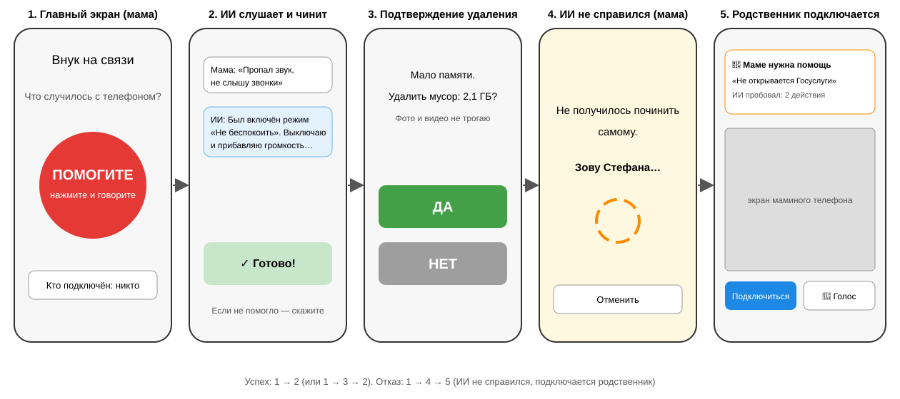
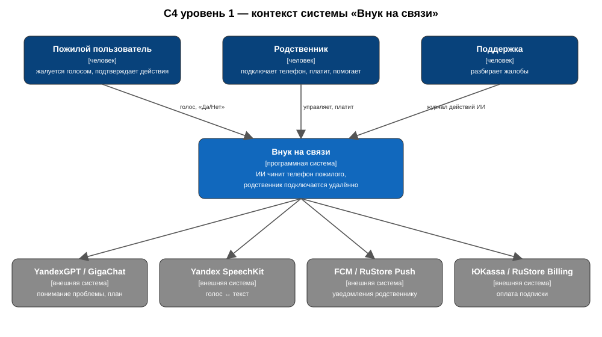
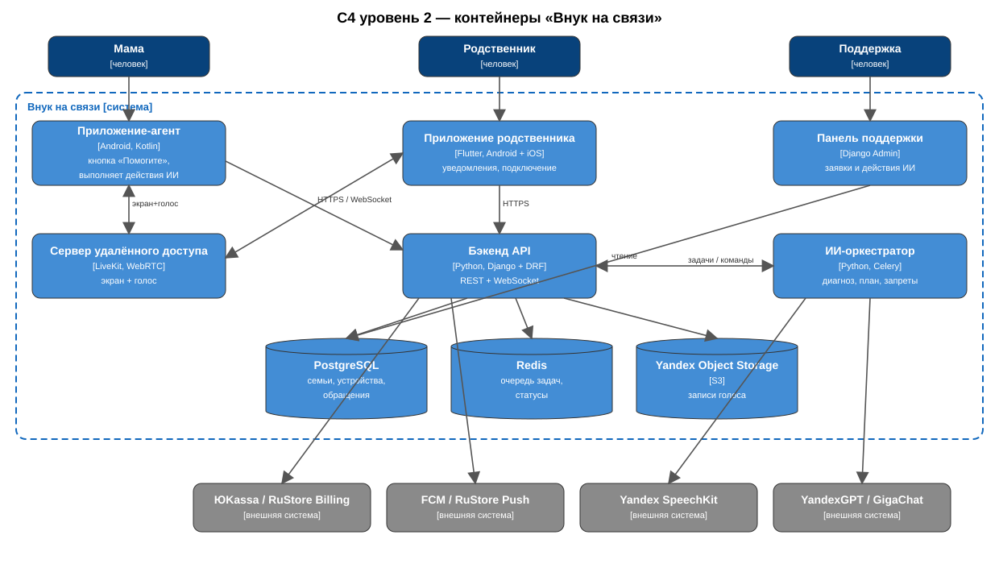

# Управление разработкой ПО. Рожков С. П., WEB-11 (ИУ1-32Б)

# ДЗ №1

## Идея: «Внук на связи» — удалённая помощь пожилым с телефоном с помощью ИИ (B2C)

## Elevator Pitch
Бабушки и мамы постоянно звонят с вопросами вроде «пропал звук» или «нет памяти», а объяснить по телефону, куда нажать, почти невозможно. «Внук на связи» решает это: ИИ сам выслушивает проблему и чинит телефон, а если не уверен, зовёт родственника, и тот подключается к телефону удалённо. Установите приложение родителям и попробуйте бесплатно.

## Lean Canvas


# ДЗ №2

## Риск и HADI
Риск ценности — будут ли дети платить, если можно просто созвониться с родителями?

* H: Дети, живущие отдельно, готовы платить, чтобы проблемы с телефоном родителей решались без них
* A: Делаем страницу с заявкой, кидаем в студенческие чаты и помогаем вручную через удалённый доступ
* D: 30 заявок за 2 недели, из них 6 готовы платить 299 ₽ в месяц
* I: Набирается — делаем приложение, нет — меняем идею

## Юнит-экономика
**CAC:** клик в рекламе VK 25 ₽, приложение ставят 15%, подключают родителя 40%, платят 10%. CAC = 25 / 0,15 / 0,4 / 0,1 ≈ 4 200 ₽

**LTV:**
* Подписка 299 ₽ в месяц, после комиссии магазина 254 ₽
* Расходы на ИИ и серверы ≈ 95 ₽
* Прибыль 159 ₽ в месяц, пользователь платит 8 месяцев
* LTV = 159 * 8 ≈ 1 270 ₽
* LTV / CAC ≈ 0,3, экономика не сходится

## Pivot
Меняем B2C на B2B: продаём сервис частным пансионатам для пожилых

## Elevator Pitch
Персонал пансионатов постоянно отвлекается на телефоны жильцов. Мы ставим приложение на их телефоны: ИИ чинит простые проблемы сам, а сложные решает администратор или родственник удалённо. 300 ₽ в месяц за телефон, первый месяц бесплатно.

## Lean Canvas


## Юнит-экономика pivot
**CAC:** менеджер за месяц обзванивает 300 пансионатов и заключает 4–5 договоров, расходы ≈ 76 000 ₽. CAC ≈ 17 000 ₽

**LTV:**
* 15 телефонов * 300 ₽ = 4 500 ₽ в месяц
* Расходы на ИИ, серверы и поддержку ≈ 2 270 ₽
* Прибыль 2 230 ₽ в месяц, пансионат пользуется 2 года
* LTV = 2 230 * 24 ≈ 53 500 ₽
* LTV / CAC ≈ 3,1, экономика сходится

# ДЗ №3

## Роли
- Пожилой пользователь — плохо разбирается в телефоне
- Родственник — помогает удалённо и платит за подписку
- Поддержка — решает проблемы пользователей

## User Stories
1) Как родственник, я хочу зарегистрироваться, чтобы пользоваться сервисом.
2) Как родственник, я хочу подключить телефон мамы по QR-коду, чтобы не вводить логины.
3) Как родственник, я хочу выдать все разрешения при установке, чтобы мама не пугалась непонятных окон.
4) Как пожилой пользователь, я хочу рассказать о проблеме голосом по одной кнопке, чтобы не печатать.
5) Как пожилой пользователь, я хочу, чтобы ИИ сам чинил простые проблемы, чтобы не ждать помощи.
6) Как пожилой пользователь, я хочу, чтобы ИИ спрашивал разрешение перед удалением, чтобы не потерять фото.
7) Как родственник, я хочу получать уведомление, если ИИ не справился, чтобы сразу помочь.
8) Как родственник, я хочу управлять телефоном мамы удалённо, чтобы не объяснять, куда нажимать.
9) Как пожилой пользователь, я хочу видеть, кто подключён к телефону, и отключить его, чтобы не попасться мошенникам.
10) Как родственник, я хочу запретить ИИ заходить в банковские приложения, чтобы не переживать за деньги.
11) Как родственник, я хочу оплатить подписку в приложении, чтобы не тратить время.
12) Как родственник, я хочу видеть историю обращений, чтобы знать, что происходит с телефоном.
13) Как родственник, я хочу говорить с мамой голосом во время подключения, чтобы не звонить отдельно.
14) Как родственник, я хочу добавить в семью брата или сестру, чтобы помогать по очереди.
15) Как сотрудник поддержки, я хочу видеть действия ИИ в заявке, чтобы разобраться с жалобой.

## Приоритизация (MoSCoW)
* M: 1–11
* S: 12, 13, 15
* C: 14
* W: поддержка iPhone

## MVP и MLP
* MVP: истории 1–12
* MLP: MVP + голосовая связь, несколько родственников в семье, инструменты поддержки

## Требования для MVP
**История 4 — обращение голосом**
* ФТ: на главном экране одна большая кнопка; приложение записывает голос и снимок экрана; ИИ решает только простые проблемы, остальные передаёт родственнику
* НФТ: ответ ИИ не дольше 10 секунд; крупный шрифт и озвучка сообщений; пароли и номера карт не попадают на снимки

**История 8 — удалённое подключение**
* ФТ: подключаться могут только родственники из семьи; на экране видно, кто подключён, и есть кнопка «Отключить»; родственник видит экран и управляет телефоном
* НФТ: экран появляется за 5 секунд; задержка не больше 0,3 секунды; данные передаются в зашифрованном виде

# ДЗ №4

## DDD — доменные зоны
Приложение делится на 6 зон, каждую может делать отдельная команда.

1. **Семья и аккаунты** — регистрация родственника, подключение телефона мамы, состав семьи.
   *Relative* — родственник, *Elder* — пожилой пользователь, *Family* — семья, *PairingCode* — QR-код для подключения телефона
2. **Устройство** — приложение-агент на телефоне мамы и его разрешения.
   *Device* — телефон, *Agent* — приложение на телефоне, *Permission* — разрешение Android (спец. возможности, запись экрана), *DeviceState* — состояние: звук, память, сеть
3. **ИИ-помощник** — разбор голосового обращения и починка телефона.
   *Request* — обращение, *VoiceMessage* — голосовое сообщение, *Diagnosis* — что сломалось, *Fix* — действие ИИ, *Confirmation* — подтверждение перед удалением, *Restriction* — запрет (например, банковские приложения), *Escalation* — передача родственнику
4. **Удалённый доступ** — подключение родственника к телефону.
   *Session* — сеанс подключения, *ScreenStream* — трансляция экрана, *RemoteControl* — управление, *VoiceChannel* — голос во время сеанса, *AccessLog* — кто и когда подключался, *Revoke* — отключение по кнопке мамы
5. **Подписка и платежи** — оплата сервиса.
   *Tariff* — тариф, *Subscription* — подписка, *Trial* — бесплатный месяц, *Payment* — платёж
6. **Поддержка** — разбор жалоб.
   *Ticket* — заявка, *ActionLog* — журнал действий ИИ, *SupportAgent* — сотрудник поддержки

## BDD — критический путь
Критический путь MVP: мама жалуется голосом → ИИ чинит сам или зовёт родственника (US 4, 5, 7 из ДЗ 3).

**Успех: ИИ починил сам**
* **Дано:** телефон мамы подключён к семье, все разрешения выданы, на телефоне включён режим «Не беспокоить»
* **Когда:** мама нажимает «Помогите» и говорит «пропал звук»
* **Тогда:** ИИ выключает «Не беспокоить», прибавляет громкость, показывает «Готово!» и записывает обращение в историю со статусом «Решено»

**Успех с подтверждением: удаление файлов**
* **Дано:** на телефоне меньше 300 МБ свободной памяти
* **Когда:** мама говорит «пишет, что нет памяти»
* **Тогда:** ИИ показывает экран «Удалить мусор: 2,1 ГБ?» и удаляет только после нажатия «Да», фото и видео не трогает

**Отказ: ИИ не справился**
* **Дано:** мама говорит «не открываются Госуслуги», ИИ попробовал 2 действия и проблема осталась
* **Когда:** ИИ не уверен в следующем шаге
* **Тогда:** маме показывается «Зову Стефана…», родственнику приходит пуш «Маме нужна помощь» с описанием проблемы и действиями ИИ, по кнопке «Подключиться» открывается экран маминого телефона

**Отказ: запрещённое приложение**
* **Дано:** родственник запретил ИИ заходить в банковские приложения
* **Когда:** мама просит «переведи деньги внучке»
* **Тогда:** ИИ не открывает банк, говорит «Это я сделать не могу, позову Стефана» и передаёт обращение родственнику

## Wireframes


Путь успеха: главный экран → ИИ слушает и чинит (при удалении — экран подтверждения). Путь отказа: ИИ не справился → родственник получает уведомление и подключается.

## API-First — JSON-контракты

### Создать обращение
`POST /api/v1/requests` (multipart: аудио + JSON)
```json
{
  "device_id": 42,
  "audio_url": "s3://voice/req-9001.ogg",
  "device_state": { "volume": 0, "dnd": true, "free_space_mb": 1200, "network": "wifi" }
}
```
**201**
```json
{ "request_id": 9001, "status": "in_progress", "text": "пропал звук, не слышу звонки" }
```
**403** — `{ "error": "SUBSCRIPTION_EXPIRED" }`

### Статус обращения (приложение мамы опрашивает или получает по WebSocket)
`GET /api/v1/requests/9001`
```json
{
  "request_id": 9001,
  "status": "solved",
  "actions": [
    { "type": "disable_dnd", "result": "ok" },
    { "type": "set_volume", "value": 80, "result": "ok" }
  ],
  "message_for_user": "Готово! Звук включён"
}
```
`status`: `in_progress` | `needs_confirmation` | `solved` | `escalated`

### Подтверждение действия
`POST /api/v1/requests/9001/confirm`
```json
{ "action_id": 3, "approved": true }
```
**200** — `{ "status": "in_progress" }`

### Подключение родственника
`POST /api/v1/sessions`
```json
{ "request_id": 9002, "device_id": 42, "with_voice": true }
```
**201**
```json
{ "session_id": "s-77", "webrtc_token": "eyJ...", "expires_in": 3600 }
```
**403** — `{ "error": "NOT_FAMILY_MEMBER" }`  
**409** — `{ "error": "ELDER_REVOKED_ACCESS" }` (мама отключила доступ)

# ДЗ №5

## C4: уровень 1, контекст


Синий — наша система, серые — внешние сервисы, с которыми интегрируемся.

## C4: уровень 2, контейнеры


Как идёт обращение: агент отправляет голос и состояние телефона в API → API кладёт задачу в Redis → ИИ-оркестратор распознаёт речь (SpeechKit), получает план от LLM, убирает запрещённые действия и отдаёт команды агенту → агент выполняет их через Accessibility Service. Если ИИ не уверен, API шлёт пуш родственнику, и тот подключается через LiveKit.

## Стек
| Часть | Технология | Почему |
|-------|------------|--------|
| Приложение мамы | Kotlin, Android | Чинить телефон можно только через Accessibility Service и запись экрана — это есть только в нативном Android. iPhone такое не позволяет (поэтому он в Won't) |
| Приложение родственника | Flutter | У родственников бывают и Android, и iPhone — один код на обе платформы |
| Бэкенд | Python + Django + DRF | Быстро собрать MVP: авторизация, ORM, миграции из коробки; Python удобен для работы с LLM |
| Панель поддержки | Django Admin | Встроена в Django, не нужно писать отдельный интерфейс (US 15) |
| Фоновая обработка ИИ | Celery + Redis | Распознавание и запрос к LLM идут несколько секунд — не держим запрос, а обрабатываем в фоне; Redis заодно хранит статусы обращений |
| База данных | PostgreSQL | Семьи, устройства, обращения и подписки связаны между собой — подходит реляционная БД |
| Удалённый доступ | LiveKit (WebRTC), свой сервер | Готовый сервер для видео и голоса с низкой задержкой: экран мамы и голосовой канал (US 8, 13) без своей реализации |
| ИИ | YandexGPT / GigaChat + SpeechKit | Хорошо понимают русскую речь, данные остаются в России (152-ФЗ) |
| Файлы | Yandex Object Storage (S3) | Записи голоса не храним в БД, серверы в России |
| Уведомления | FCM + RuStore Push | Пуш родственнику, если ИИ не справился (US 7) |
| Оплата | RuStore Billing / ЮKassa | Подписка внутри приложения (US 11) и оплата по счёту для пансионатов после pivot |

Для MVP бэкенд — модульный монолит (API + фоновые задачи Celery в одном проекте): так быстрее запустить первую версию, а доменные зоны из ДЗ 4 потом можно вынести в отдельные сервисы.
