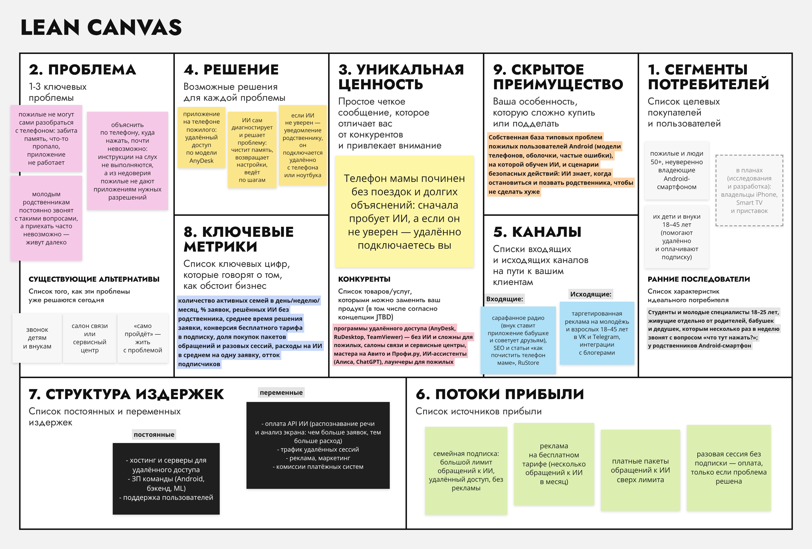
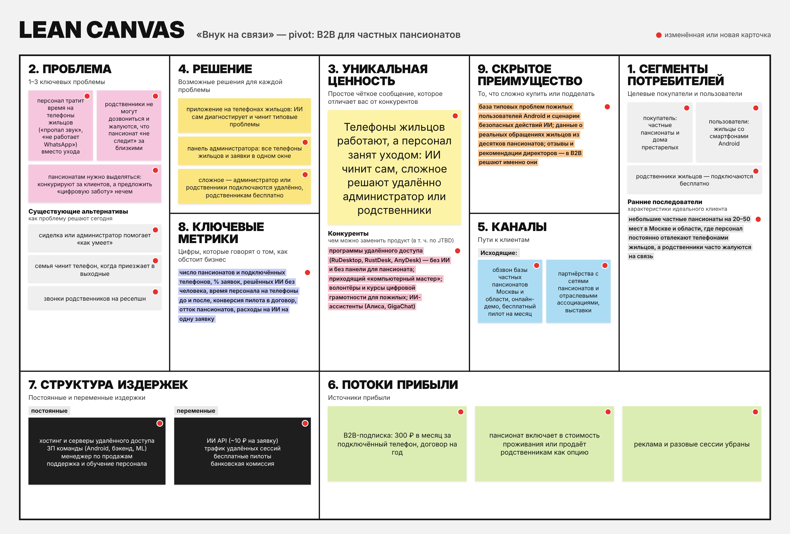

# Управление разработкой ПО. Рожков С. П., WEB-11 (ИУ1-32Б)

# ДЗ №1

## Идея: «Внук на связи» — удалённая помощь пожилым с телефоном с помощью ИИ (B2C)

## Elevator Pitch
Бабушки и мамы постоянно звонят с вопросами вроде «пропал звук» или «нет памяти», а объяснить по телефону, куда нажать, почти невозможно. «Внук на связи» решает это: ИИ сам выслушивает проблему и чинит телефон, а если не уверен, зовёт родственника, и тот подключается к телефону удалённо. Установите приложение родителям и попробуйте бесплатно.

## Lean Canvas

# ДЗ №2

## Риск и HADI
Риск ценности — будут ли дети платить, если можно просто созвониться с родителями?

* H: Дети, живущие отдельно, готовы платить, чтобы проблемы с телефоном родителей решались без них
* A: Делаем страницу с заявкой, кидаем в студенческие чаты и помогаем вручную через удалённый доступ
* D: 30 заявок за 2 недели, из них 6 готовы платить 299 ₽ в месяц
* I: Набирается — делаем приложение, нет — меняем идею

## Юнит-экономика
**CAC:** клик в рекламе VK 25 ₽, приложение ставят 15%, подключают родителя 40%, платят 10%. CAC = 25 / 0,15 / 0,4 / 0,1 ≈ 4 200 ₽

**LTV:**
* Подписка 299 ₽ в месяц, после комиссии магазина 254 ₽
* Расходы на ИИ и серверы ≈ 95 ₽
* Прибыль 159 ₽ в месяц, пользователь платит 8 месяцев
* LTV = 159 * 8 ≈ 1 270 ₽
* LTV / CAC ≈ 0,3, экономика не сходится

## Pivot
Меняем B2C на B2B: продаём сервис частным пансионатам для пожилых

## Elevator Pitch
Персонал пансионатов постоянно отвлекается на телефоны жильцов. Мы ставим приложение на их телефоны: ИИ чинит простые проблемы сам, а сложные решает администратор или родственник удалённо. 300 ₽ в месяц за телефон, первый месяц бесплатно.

## Lean Canvas

## Юнит-экономика pivot
**CAC:** менеджер за месяц обзванивает 300 пансионатов и заключает 4–5 договоров, расходы ≈ 76 000 ₽. CAC ≈ 17 000 ₽

**LTV:**
* 15 телефонов * 300 ₽ = 4 500 ₽ в месяц
* Расходы на ИИ, серверы и поддержку ≈ 2 270 ₽
* Прибыль 2 230 ₽ в месяц, пансионат пользуется 2 года
* LTV = 2 230 * 24 ≈ 53 500 ₽
* LTV / CAC ≈ 3,1, экономика сходится

# ДЗ №3

## Роли
- Пожилой пользователь — плохо разбирается в телефоне
- Родственник — помогает удалённо и платит за подписку
- Поддержка — решает проблемы пользователей

## User Stories
1) Как родственник, я хочу зарегистрироваться, чтобы пользоваться сервисом.
2) Как родственник, я хочу подключить телефон мамы по QR-коду, чтобы не вводить логины.
3) Как родственник, я хочу выдать все разрешения при установке, чтобы мама не пугалась непонятных окон.
4) Как пожилой пользователь, я хочу рассказать о проблеме голосом по одной кнопке, чтобы не печатать.
5) Как пожилой пользователь, я хочу, чтобы ИИ сам чинил простые проблемы, чтобы не ждать помощи.
6) Как пожилой пользователь, я хочу, чтобы ИИ спрашивал разрешение перед удалением, чтобы не потерять фото.
7) Как родственник, я хочу получать уведомление, если ИИ не справился, чтобы сразу помочь.
8) Как родственник, я хочу управлять телефоном мамы удалённо, чтобы не объяснять, куда нажимать.
9) Как пожилой пользователь, я хочу видеть, кто подключён к телефону, и отключить его, чтобы не попасться мошенникам.
10) Как родственник, я хочу запретить ИИ заходить в банковские приложения, чтобы не переживать за деньги.
11) Как родственник, я хочу оплатить подписку в приложении, чтобы не тратить время.
12) Как родственник, я хочу видеть историю обращений, чтобы знать, что происходит с телефоном.
13) Как родственник, я хочу говорить с мамой голосом во время подключения, чтобы не звонить отдельно.
14) Как родственник, я хочу добавить в семью брата или сестру, чтобы помогать по очереди.
15) Как сотрудник поддержки, я хочу видеть действия ИИ в заявке, чтобы разобраться с жалобой.

## Приоритизация (MoSCoW)
* M: 1–11
* S: 12, 13, 15
* C: 14
* W: поддержка iPhone

## MVP и MLP
* MVP: истории 1–12
* MLP: MVP + голосовая связь, несколько родственников в семье, инструменты поддержки

## Требования для MVP
**История 4 — обращение голосом**
* ФТ: на главном экране одна большая кнопка; приложение записывает голос и снимок экрана; ИИ решает только простые проблемы, остальные передаёт родственнику
* НФТ: ответ ИИ не дольше 10 секунд; крупный шрифт и озвучка сообщений; пароли и номера карт не попадают на снимки

**История 8 — удалённое подключение**
* ФТ: подключаться могут только родственники из семьи; на экране видно, кто подключён, и есть кнопка «Отключить»; родственник видит экран и управляет телефоном
* НФТ: экран появляется за 5 секунд; задержка не больше 0,3 секунды; данные передаются в зашифрованном виде
