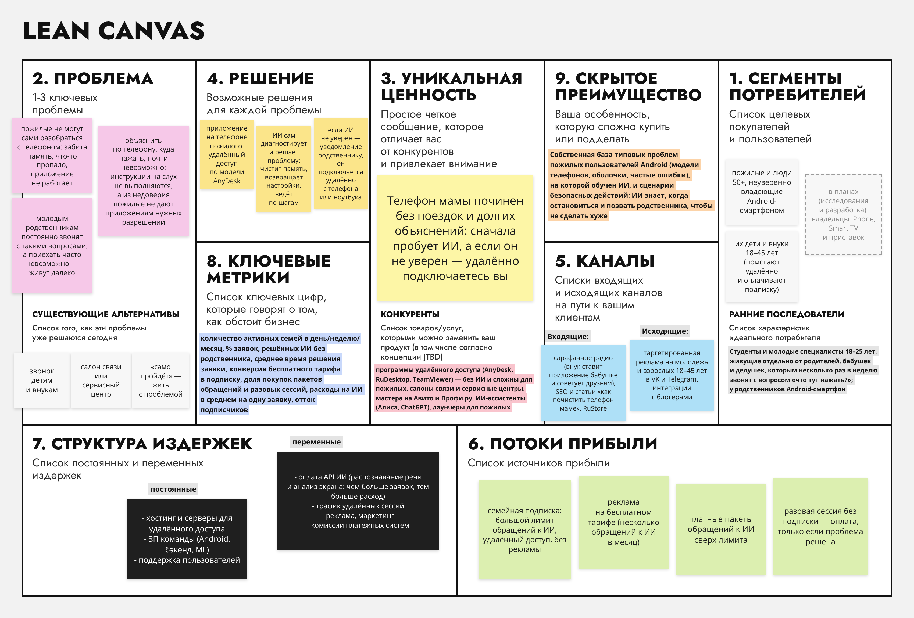

# ДЗ №1 по предмету "Управление разработкой ПО". Фамилия И. О., группа WEB-XX (ИУ1-32Б)

## Моя идея: Приложение удалённой техподдержки для пожилых с ИИ "Внук на связи" (b2c)

**Elevator Pitch**

Почти каждому молодому человеку хоть раз звонила бабушка или мама с вопросом: "телефон пишет, что нет памяти", "пропал звук", "куда делись фотографии?". Объяснить по телефону, куда нажать, почти невозможно: пожилым трудно выполнять инструкции на слух, а из недоверия они не дают приложениям нужных разрешений. Приехать тоже получается не всегда, особенно если живёшь в другом городе. Наше приложение "Внук на связи" решает эту проблему. Это удалённый доступ к телефону пожилого родственника, как в AnyDesk, только основную работу делает ИИ: он выслушивает проблему, сам диагностирует телефон, чистит память и возвращает нужные настройки. Если ИИ не уверен, что справится без риска что-то сломать, он не рискует, а отправляет уведомление родственнику, и тот подключается к телефону удалённо со своего смартфона или ноутбука. В итоге пожилые люди получают помощь за считанные минуты, а их дети и внуки перестают тратить вечера на объяснения по телефону. Установите приложение родителям и попробуйте бесплатный тариф уже сегодня!

**Lean Canvas**

